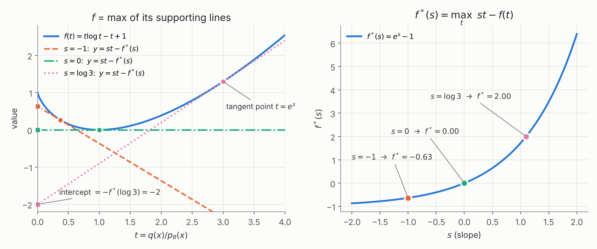
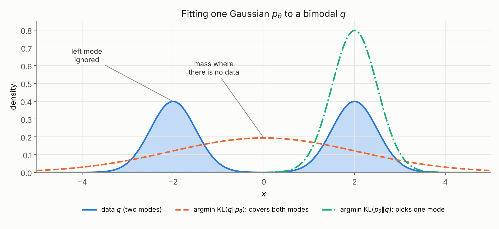
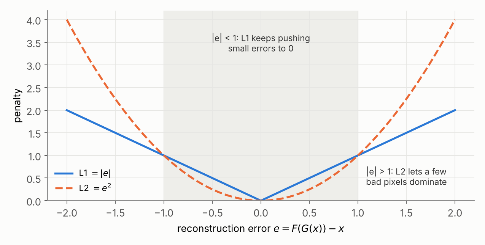
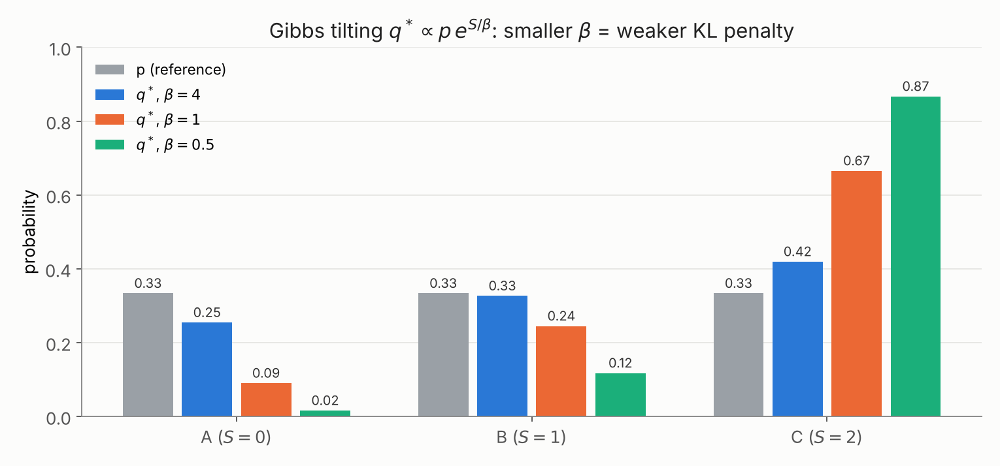

*Generative Models, part 1 of 3. Next: [Optimal Transport](/blog/post.html?f=2026-11-14-optimal-transport.md).*

Notes on [CS886 Lecture 01](https://cs.uwaterloo.ca/~y328yu/teaching/886/lec01.pdf). Notation: \(\simeq\) = "distributed as".

## 1. Random variable & push-forward

$$
\mathsf{X} : (\Omega, \mathcal{F}, \mu) \to (\mathbb{S}, \mathcal{B}), \qquad (\mathsf{X}_\#\mu)(B) := \mu(\mathsf{X}^{-1}(B))
$$

- \(\mathsf{X}\) is a deterministic function; randomness lives in \(\mu\).
- Measurability: \(\mathsf{X}^{-1}(\mathcal{B}) \subseteq \mathcal{F}\).
- Measures pushed forward, sets pulled back.
- Many \(\omega\) → one value ⇒ mass adds up.
- \(\Omega\) = shared source of randomness (gives joints, independence).
- \(\mathbb{S}\) = observed values.
- "\(\mathsf{X}\simeq\mathcal{N}(0,1)\)" means \(\mathsf{X}_\#\mu = \mathcal{N}(0,1)\).
- **Sampling:** \(\varepsilon \simeq \mu \Rightarrow \mathsf{X}(\varepsilon) \simeq \mathsf{X}_\#\mu\).
- \(\mathbb{E}_{x\sim T_\#\mu}[g(x)] = \mathbb{E}_{z\sim\mu}[g(T(z))]\).

## 2. Function ⇄ distribution

$$
\mu[f(\mathsf{X}) \in S] = \mu[\mathsf{X}^{-1}(f^{-1}(S))] = [f_\#(\mathsf{X}_\#\mu)](S) \;\Rightarrow\; (f\circ\mathsf{X})_\#\mu = f_\#[\mathsf{X}_\#\mu]
$$

- \(f\) acts on values, not probabilities: \(f_\#(\mathsf{X}_\#\mu) \ne (\mathsf{X}_\#\mu)^2\).
- **Inverse problem:** given \(P, Q\), find \(f\) with \(f_\#P = Q\).
- Function → distribution is many-to-one ⇒ \(f\) not unique.
- Example, \(\mathsf{X}\simeq\mathcal{N}(0,1)\): both \(x^2\) and \(\Psi^{-1}\circ\Phi\) give \(\chi^2_1\).
  - \(\Phi(\mathsf{X}) \simeq \mathrm{Unif}[0,1]\), then \(\Psi^{-1}\) maps uniform to \(\chi^2_1\).

## 3. Theorem: representation through push-forward

> \(P\) continuous on \(\mathbb{R}^m\), \(Q\) any distribution on \(\mathbb{R}^d\) ⇒ \(\exists f : \mathbb{R}^m\to\mathbb{R}^d\) with \(f_\#P = Q\).

- False if \(P\) has a delta mass (maps cannot split a point).
- W.l.o.g. \(P\) = standard Gaussian.
- \(f\) not unique.
- \(f\) weird if \(m \ll d\) (non-Lipschitz).
- Practice: only empirical \(\hat Q\).

## 4. MLE ≈ min KL

$$
\min_\theta \mathrm{KL}(q\|p_\theta) \;\equiv\; \min_\theta H(q, p_\theta) \;\approx\; \min_\theta -\frac1n\sum_{i=1}^n \log p_\theta(\mathbf{x}_i) = \text{MLE}
$$

> \(H(q, p_\theta) = H(q) + \mathrm{KL}(q\|p_\theta)\)

- \(\equiv\): \(H(q)\) is constant in \(\theta\) ⇒ same minimizer, not same value.
- Equal in value only if \(H(q) = 0\) (one-hot labels).
- \(\approx\): Monte Carlo with \(\mathbf{x}_i \sim q\).
- Needs explicit \(p_\theta\); push-forward models only give samples.

## 5. Any Gaussian from the standard Gaussian

$$
\mathbf{n}\sim\mathcal{N}(\mathbf{0}, I),\quad S = LL^\top,\quad \mathbf{x} = L\mathbf{n} + \boldsymbol{\mu} \;\Rightarrow\; \mathbf{x}\sim\mathcal{N}(\boldsymbol{\mu}, S)
$$

- Linear map of Gaussian is Gaussian.
- \(\mathbb{E}\mathbf{x} = \boldsymbol{\mu}\), \(\mathrm{Cov}\,\mathbf{x} = LL^\top = S\).
- \(L\) not unique (\(LQ\), \(Q\) orthogonal).
- = reparameterization trick in \(d\) dims.

## 6. KL with both sides unknown → GAN

Goal: write KL using only \(\mathbb{E}_q[\cdot]\) and \(\mathbb{E}_{p_\theta}[\cdot]\).

**f-divergence:** \(D_f(q\|p) = \int f(q/p)\,p\,d\mathbf{x}\), \(f\) convex, \(f(1) = 0\).

- KL: \(f(t) = t\log t - t + 1\).

**Fenchel conjugate:** \(f^*(s) := \max_t st - f(t)\).

- \(f^*\) always convex.
- \(f = f^{**}\) if \(f\) convex, continuous.

*Left: \(f\) and three supporting lines; squares on \(t = 0\) mark the intercepts \(-f^*(s)\). Right: \(f^*(s)\), with the same three slopes.*

- Supporting line with slope \(s\): \(y = st - f^*(s)\), so \(f^*(s)\) = −intercept.
- \(f\) = upper envelope of its supporting lines.
- Optimal \(s = f'(t)\).
- KL: \(f'(t) = \log t\) ⇒ \(f^*(s) = e^s - 1\).

**Duality:**

$$
\begin{aligned}
\min_\theta \mathrm{KL}(q\|p_\theta) &\equiv \int \tfrac{q}{p_\theta}\big[\log\tfrac{q}{p_\theta} - 1\big] p_\theta\,d\mathbf{x} \\
&\equiv \int \big[\max_s\, s\tfrac{q}{p_\theta} - e^s\big] p_\theta\,d\mathbf{x} \\
&= \int \big[\max_s\, s\,q - e^s p_\theta\big] d\mathbf{x} \\
&= \max_{S:\mathbb{R}^d\to\mathbb{R}} \int \big[S q - e^{S} p_\theta\big] d\mathbf{x} \\
&\approx \max_S\; \frac1n\sum_i S(\mathbf{x}_i) - \frac1m\sum_j \exp\big[S(\mathbf{T}_\theta(\mathbf{z}_j))\big]
\end{aligned}
$$

- \(\pm1\) constants dropped.
- Line 3: \(t\) appears linearly ⇒ ratio cancels.
- Line 4: each \(\mathbf{x}\) picks its own \(s\) ⇒ a function \(S\).
- Line 5: \(\mathbb{E}_{p_\theta}\) via samples \(\mathbf{T}_\theta(\mathbf{z}_j)\).
- Optimal: \(q - e^s p_\theta = 0 \Rightarrow S^* = \log(q/p_\theta)\) (\(= f'(t)\), not \(t\)).

**GAN:**

$$
\min_\theta \mathrm{KL}(q\|p_\theta) \approx \min_\theta\max_\phi\; \frac1n\sum_i S_\phi(\mathbf{x}_i) - \frac1m\sum_j \exp\big[S_\phi(\mathbf{T}_\theta(\mathbf{z}_j))\big]
$$

- \(\mathbf{T}_\theta\): generator.
- \(S_\phi\): discriminator.
- Network \(S_\phi\) ⇒ lower bound on KL.

## 7. JS divergence

**Support:**

- Forward KL blows up where \(q > 0\), \(p_\theta \approx 0\) ⇒ mode covering.
- Reverse KL blows up where \(p_\theta > 0\), \(q \approx 0\) ⇒ mode seeking.

*Forward KL puts mass between the modes; reverse KL ignores the left mode.*

$$
\mathrm{JS}(q\|p_\theta) := \mathrm{KL}\big(q\,\|\,\tfrac{q+p_\theta}{2}\big) + \mathrm{KL}\big(p_\theta\,\|\,\tfrac{q+p_\theta}{2}\big) = \int f\big(\tfrac{q}{p_\theta}\big)p_\theta\,d\mathbf{x}
$$

$$
f(t) = t\log t - (t+1)\log(t+1) + \log 4, \qquad f^*(s) = -\log(1 - e^s) - \log 4,\ s < 0
$$

- Range \([0, \log 4]\).
- Disjoint supports ⇒ \(\log 4\) ⇒ no gradient.
- Derive \(f\): divide by \(p_\theta\); the two \(\log 2\) terms integrate to \(\log 4\).
- Derive \(f^*\): \(s = f'(t) = \log\frac{t}{t+1}\).

**Min-max, then \(S_\phi \leftarrow \log S_\phi\):**

$$
\min_\theta\max_\phi\; \frac1n\sum_i \log S_\phi(\mathbf{x}_i) + \frac1m\sum_j \log\big[1 - S_\phi(\mathbf{T}_\theta(\mathbf{z}_j))\big]
$$

- \(\max_\phi\) covers both terms.
- \(\theta\) appears only in the second term.
- Binary classifier: \(\log\mathfrak{p}_y = y\log S + (1-y)\log(1-S) = -\mathrm{BCE}\).
- Objective \(= \hat{\mathbb{E}}\log\mathfrak{p}_\mathsf{Y}(\mathsf{X})\).
- \(S^* = \frac{q}{q+p_\theta}\).
- At \(p_\theta = q\): \(S^* = \frac12\).

**KL vs. JS** (only the generated term differs, \(D = e^S\)):

- KL: \(-D\).
- JS: \(\log(1-D)\).
- \(\approx\) equal for small \(D\).

**Optimization:** \(g(\theta) := \max_\phi \hat{\mathbb{E}}\log\mathfrak{p}_\mathsf{Y}(\mathsf{X})\).

- Generator: stochastic gradient descent on \(\theta\), needs \(\nabla g(\theta)\).
- Ideal: fix \(\theta\), stochastic gradient ascent on \(\phi\) until convergence.
- Danskin: \(\nabla g(\theta)\) = gradient at fixed optimal \(\phi^*\).
- Practice: alternate.
  1. A few ascent steps on \(\phi\) (discriminator).
  2. One descent step on \(\theta\) (generator).
  3. Repeat.
- \(\phi\) not optimal ⇒ Danskin fails ⇒ can cycle (\(\min_{\theta\in[-1,1]}\max_{\phi\in[-1,1]} \theta\phi\)).
- Fix: better algorithms, iterate averaging.

> **InfoNCE vs. BCE:** both learn a log density ratio by classification.
>
> - BCE: binary (NCE, GAN).
> - InfoNCE: \((K+1)\)-way softmax, \(\mathcal{L} = -\log\frac{e^{s(x,y^+)}}{\sum_k e^{s(x,y_k)}}\).
> - \(I(x;y) \ge \log(K+1) - \mathcal{L}\).
> - CLIP: InfoNCE. SigLIP: sigmoid BCE.

## 8. CycleGAN

- Unpaired \(X\), \(Y\). Want \(G_\#P_X = P_Y\).
- \(G\) not unique ⇒ add cycle consistency.

$$
\begin{aligned}
\min_{G,F}\max_{D_X,D_Y}\;& \mathbb{E}[\log D_Y(\mathsf{Y})] + \mathbb{E}[\log(1 - D_Y(G(\mathsf{X})))] \\
+\;& \mathbb{E}[\log D_X(\mathsf{X})] + \mathbb{E}[\log(1 - D_X(F(\mathsf{Y})))] \\
+\;& \mathbb{E}\|F(G(\mathsf{X})) - \mathsf{X}\|_1 + \mathbb{E}\|G(F(\mathsf{Y})) - \mathsf{Y}\|_1
\end{aligned}
$$

*L1 vs. L2 penalty per pixel.*

**Why L1:**

- L1 optimum = median (sharp); L2 optimum = mean (blur).
- Robust to a few large errors.
- Keeps pushing small errors to 0.

**Failure:** steganography (hide info in invisible noise).

## 9. Donsker–Varadhan

$$
\begin{aligned}
\mathrm{KL}(q\|p) &= \max_S \int \big[S q - e^S p\big] \\
&= \max_S\max_t \int \big[(S-t) q - e^{S-t} p\big] \\
&= \max_S\max_t \int S q - t - e^{-t}\int e^S p
\end{aligned}
$$

- \(t^* = \log\int e^S p\), giving

> \(\mathrm{KL}(q\|p) = \max_S\ \mathbb{E}_q[S] - \log\mathbb{E}_p[e^S]\)

- Fixed \(S\) ⇒ lower bound.
- Tighter than NWJ \(\mathbb{E}_q S - \mathbb{E}_p e^S + 1\), since \(\log u \le u - 1\).
- Invariant to \(S \to S + c\).
- Minibatch \(\log\) is biased (MINE uses a moving average).

**Gibbs variational principle:**

$$
\log\mathbb{E}_p[e^S] = \sup_q\ \mathbb{E}_q[S] - \mathrm{KL}(q\|p), \qquad q^* = p\,e^S/Z
$$

- Proof: \(\mathbb{E}_q[S] - \mathrm{KL}(q\|p) = \log Z - \mathrm{KL}(q\|q^*) \le \log Z\).

*\(p\) uniform over A, B, C with \(S = (0, 1, 2)\); \(q^*\) for three temperatures \(\beta\) (using \(S/\beta\)).*

| fix | max over | get | optimum |
| --- | --- | --- | --- |
| \(q, p\) | \(S\) | \(\mathrm{KL}(q\|p)\) | \(S^* = \log(q/p) + c\) |
| \(S, p\) | \(q\) | \(\log\mathbb{E}_p[e^S]\) | \(q^* \propto p\,e^S\) |

## 10. Projected GAN

$$
\min_G\max_{D_k}\ \sum_k \mathbb{E}\big[\log D_k(P_k(\mathsf{X}))\big] + \mathbb{E}\big[\log(1 - D_k(P_k(G(\mathsf{Z}))))\big]
$$

- \(P_k\): frozen pretrained features at level \(k\).
- Matches \(P_{k\#}q\) vs. \(P_{k\#}p_\theta\).
- Data processing inequality: \(D_f(P_\#q\|P_\#p) \le D_f(q\|p)\) ⇒ lower bound.
- Equal distributions only if \(P_k\) injective.
- Faster convergence (≈ 1/17 time to StyleGAN2-ADA's FID).
- Less overfitting.
