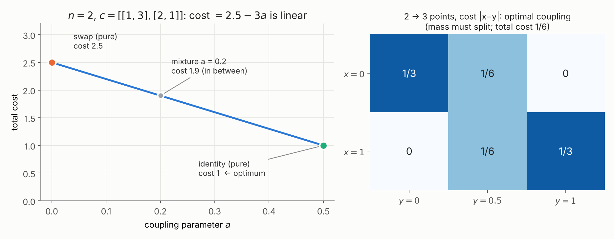
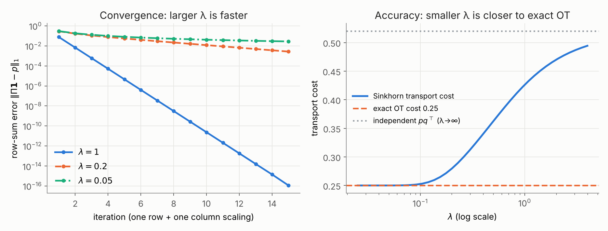
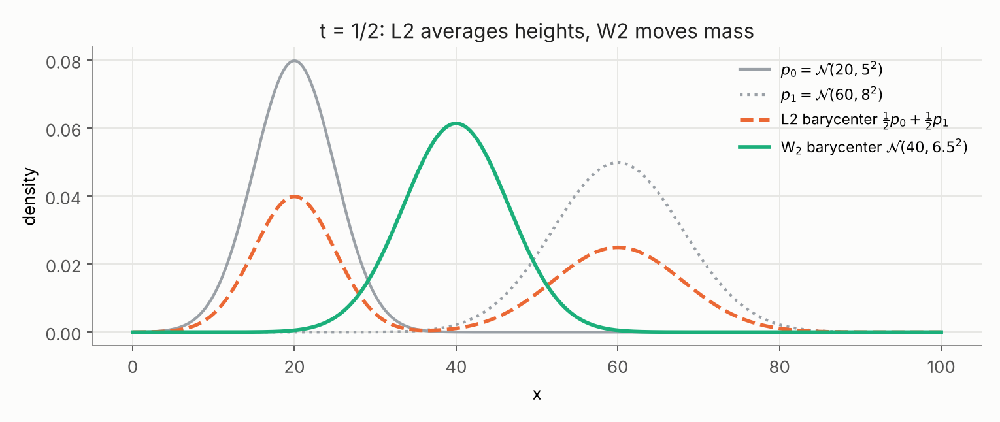

*Generative Models, part 2 of 3. Previous: [Push-forward, Divergences & GANs](/blog/post.html?f=2026-11-14-gans.md). Next: [Distillation](/blog/post.html?f=2026-11-15-distillation.md).*

Notes on [CS886 Lecture 01](https://cs.uwaterloo.ca/~y328yu/teaching/886/lec01.pdf), continued.

**Why:** push-forward maps with \(T_\#p = q\) are not unique; pick the cheapest one.

## 1. Stable matching

- \(n\) women, \(n\) men, each ranks the other side.
- **Blocking pair:** \((i,j)\), \((i',j')\) matched, but \(i\) and \(j'\) prefer each other.
- **Stable:** no blocking pair.

## 2. Gale–Shapley (deferred acceptance)

1. Each free woman proposes to her best man who hasn't rejected her.
2. Each man tentatively keeps his best proposal, rejects the rest.
3. Repeat until all matched.

- Terminates: \(\le n^2\) proposals.
- Stable, by contradiction: suppose \((w,m)\) blocks.
  - \(w\) proposed to \(m\) earlier.
  - \(m\) rejected her for someone better.
  - His partners only improve ⇒ \(m\) doesn't prefer \(w\).
- Proposer-optimal, receiver-pessimal among all stable matchings.

## 3. Costs and linear assignment

- Optimality ⇒ no profitable swap: \(c(i,j) + c(i',j') \le c(i,j') + c(i',j)\).
  - Necessary only; full condition = cyclic monotonicity.
- Linear assignment: \(\min_{T \text{ permutation}} \sum_i c(i, T(i))\).
- \(n!\) options.

## 4. Discrete optimal transport

$$
\min_{\pi\in\Pi(p,q)} \sum_{i,j} \pi_{ij}\,c(i,j), \qquad \Pi(p,q) = \{\pi\ge0 : \pi\mathbf{1} = p,\ \pi^\top\mathbf{1} = q\}
$$

- Coupling \(\pi\) = joint of \((I,J)\) with marginals \(p, q\).
- Cost \(= \mathbb{E}_\pi[c(I,J)]\).
- A linear program.
- Mass can split, e.g. \(p\) = 2 points, \(q\) = 3 points: one-to-one impossible.

*Left: \(n = 2\), cost along the coupling segment is linear, so the optimum is a pure plan. Right: optimal coupling for the 2 → 3 example.*

## 5. Monge and Kantorovich

**Monge:**

$$
\min_{\mathbf{T}_\# p = q} \mathbb{E}\big[c(\mathsf{X}, \mathbf{T}(\mathsf{X}))\big], \quad \mathsf{X}\sim p
$$

- Soil \(p\), holes \(q\).
- \(\mathbf{T}\) moves each pile to one hole.
- A feasible \(\mathbf{T}\) may not exist (cannot split mass).

**Kantorovich:**

$$
\min_{\mathbf{T}_\# p = q} \mathbb{E}\big[c(\mathsf{X}, \mathbf{T}(\mathsf{X}))\big] \;\ge\; \min_{\mathsf{X}\sim p,\ \mathsf{Y}\sim q} \mathbb{E}\big[c(\mathsf{X}, \mathsf{Y})\big]
$$

> **Coupling:** \((\mathsf{X}, \mathsf{Y})\sim\pi\), where the joint \(\pi\) has marginals \(p\) and \(q\).

- Deterministic pairing: \(\mathbf{y} = \mathbf{T}\mathbf{x}\).
- Stochastic pairing: \(\pi(\mathbf{y}|\mathbf{x})\).
- \(\ge\): every \(\mathbf{T}\) gives a coupling \((\mathsf{X}, \mathbf{T}(\mathsf{X}))\) ⇒ min over a bigger set.
- At optimality \(\pi(\mathbf{y}|\mathbf{x})\) can still be deterministic.

## 6. Relaxation of linear assignment (\(m = n\), \(p = q = \frac1n\mathbf{1}\))

| term | definition |
| --- | --- |
| pure plan | permutation matrix \(/n\) |
| coupling | any \(\pi\in\Pi(p,q)\) |
| mixture | coupling written as a weighted average of pure plans |

- Pure plans \(\subset\) couplings = all mixtures of pure plans.
- Relaxation = optimize over a superset ⇒ optimum \(\le\).
- **Lossless:** equal, attained at an original option.
- **Lossy:** strictly better (e.g. fractional knapsack).
- Lossless here: cost linear ⇒ mixture cost = weighted average of pure costs \(\ge\) best pure cost.

## 7. Vertices = pure plans (Birkhoff–von Neumann)

**Vertex** of a convex set: not a weighted average of two other distinct points.

**Pure ⇒ vertex:**

- Suppose \(P = \frac12(A+B)\).
- Zeros of \(P\) force zeros in \(A, B\).
- Row sums force the remaining entries ⇒ \(A = B = P\).

**Non-pure ⇒ not vertex:**

- Fractional entry ⇒ another in its row ⇒ another in that column ⇒ … ⇒ a cycle.
- Alternate \(\pm1\) on the cycle ⇒ \(D\) with zero row/column sums.
- \(\pi = \frac12[(\pi+\varepsilon D) + (\pi-\varepsilon D)]\).

**Conclusion:** LP optimum is at a vertex ⇒ relaxed optimum is a permutation.

## 8. IPF / Sinkhorn

$$
\min_{\Pi\in\mathscr{P}(p,q)} \sum_{i,j}\big[\pi_{ij}c_{ij} + \lambda\,\pi_{ij}\log\pi_{ij}\big] = \min_{\Pi\in\mathscr{P}(p,q)} \lambda\cdot\mathrm{KL}\big[\Pi\,\|\,\exp(-C/\lambda)\big]
$$

- \(\pi c + \lambda\pi\log\pi = \lambda\pi\log\frac{\pi}{e^{-c/\lambda}}\).
- \(\Gamma = \exp(-C/\lambda)\): unnormalized Boltzmann–Gibbs.
- Problem = KL projection of \(\Gamma\) onto couplings.

**Algorithm:** alternate the two constraints (each has a closed-form KL projection).

- Rows: \(\Gamma \leftarrow \mathrm{diag}(p\,./\,(\Gamma\mathbf{1}))\,\Gamma\)
- Columns: \(\Gamma \leftarrow \Gamma\,\mathrm{diag}(q\,./\,(\Gamma^\top\mathbf{1}))\)
- Solution: \(\Pi^* = \mathrm{diag}(u)\,\Gamma\,\mathrm{diag}(v)\).

**Choosing \(\lambda\):**

- \(\lambda\to0\): exact OT, slow.
- \(\lambda\to\infty\): \(pq^\top\), fast.

*Left: convergence per iteration. Right: transport cost vs. \(\lambda\), between exact OT and the independent coupling.*

**Hungarian algorithm (exact linear assignment):**

- Subtracting a constant from a row/column doesn't change the optimal permutation.
- Steps:
  1. Row-reduce, then column-reduce.
  2. Cover all zeros with the fewest lines.
  3. \(n\) lines ⇒ done.
  4. Else: subtract the smallest uncovered \(k\) from uncovered entries, add \(k\) at intersections, go to 2.
- Reductions \(u_i, v_j\) are dual variables: \(c_{ij} - u_i - v_j \ge 0\).
- Sinkhorn = soft version: \(\log\pi_{ij} = -\frac1\lambda(c_{ij} - f_i - g_j)\).
- \(\min\) → \(\mathrm{softmin}_\lambda(z) = -\lambda\log\sum e^{-z/\lambda}\).

## 9. Duality

> $$ \min_{(\mathsf{X},\mathsf{Y})\sim\pi,\ \mathsf{X}\sim p,\ \mathsf{Y}\sim q} \mathbb{E}\big[c(\mathsf{X},\mathsf{Y})\big] = \max_{u,v}\ \mathbb{E}_{p}[u(\mathsf{X})] + \mathbb{E}_{q}[v(\mathsf{Y})] \quad \text{s.t. } u(\mathbf{x}) + v(\mathbf{y}) \le c(\mathbf{x},\mathbf{y})\ \forall\mathbf{x},\mathbf{y} $$

Min cost under marginal constraints = max expected potentials under a pointwise cost constraint.

$$
\begin{aligned}
&\min_{\pi\ge0}\max_{u,v} \int [c - u - v]\,\pi + \int u\,p + \int v\,q \\
=\;&\max_{u,v}\min_{\pi\ge0} \int [c - u - v]\,\pi + \int u\,p + \int v\,q \\
=\;&\max_{u,v} \int u\,p + \int v\,q \quad \text{s.t. } u + v \le c
\end{aligned}
$$

- Line 1: Lagrangian; \(\max_{u,v} = +\infty\) unless marginals hold.
- Line 2: strong duality (swap).
- Line 3: if \(c - u - v < 0\) anywhere, \(\min_\pi = -\infty\).
- Weak duality: \(\mathbb{E}_\pi[c] \ge \mathbb{E}_\pi[u + v] = \mathbb{E}_p[u] + \mathbb{E}_q[v]\).

## 10. Conjugacy (c-transform)

$$
u(\mathbf{x}) \le \min_{\mathbf{y}}\ c(\mathbf{x},\mathbf{y}) - v(\mathbf{y}) =: v^c(\mathbf{x}), \qquad v(\mathbf{y}) \le \min_{\mathbf{x}}\ c(\mathbf{x},\mathbf{y}) - u(\mathbf{x}) =: u^c(\mathbf{y})
$$

- At optimality: \(u = v^c\), \(v = u^c\).
- Discrete: Hungarian row/column reduction.
- Analog of Fenchel \(f^*(s) = \max_t st - f(t)\).
- For \(c = -\langle\mathbf{x},\mathbf{y}\rangle\): \(v^c = -(-v)^*\).

**Properties:**

- \(u^{cc} \ge u\):
  - \(u^c(\mathbf{y}) \le c(\mathbf{x},\mathbf{y}) - u(\mathbf{x})\ \forall\mathbf{x}\)
  - ⇒ \(c(\mathbf{x},\mathbf{y}) - u^c(\mathbf{y}) \ge u(\mathbf{x})\ \forall\mathbf{y}\)
  - ⇒ min over \(\mathbf{y}\) is still \(\ge u(\mathbf{x})\).
- \(u^{ccc} = u^c\):
  - Order-reversing ⇒ \(\le\).
  - Apply \(u^{cc}\ge u\) to \(u^c\) ⇒ \(\ge\).
- **c-concave:** \(u = u^{cc}\) ⟺ \(u = v^c\) for some \(v\).
- The dual optimum can be taken c-concave.

## 11. Complementarity

$$
\max_{u,v}\min_{\pi\ge0} \int [c - u - v]\,\pi + \int u\,p + \int v\,q
$$

> \(\pi(\mathbf{x},\mathbf{y}) > 0 \;\Longrightarrow\; u(\mathbf{x}) + v(\mathbf{y}) = c(\mathbf{x},\mathbf{y})\)

- At optimum: \(\int c\,\pi^* = \int u\,p + \int v\,q = \int (u+v)\,\pi^*\).
- ⇒ \(\int [c - u - v]\,\pi^* = 0\), with \(c - u - v \ge 0\).
- ⇒ \(c - u - v = 0\) wherever \(\pi > 0\).
- Discrete: Hungarian assignment lies on the zeros.

**Subdifferential** (with \(v = u^c\)):

$$
\partial u(\mathbf{x}) := \operatorname*{argmin}_{\mathbf{y}}\big[c(\mathbf{x},\mathbf{y}) - u^c(\mathbf{y})\big] = \{\mathbf{y} : u(\mathbf{x}) + u^c(\mathbf{y}) = c(\mathbf{x},\mathbf{y})\}
$$

- = the possible destinations of \(\mathbf{x}\).
- Two forms equal because \(u = u^{cc}\), i.e. \(u(\mathbf{x}) = \min_{\mathbf{y}} [c - u^c]\).
- For c-concave \(u\): \(\mathbf{y}\in\partial u(\mathbf{x}) \iff \mathbf{x}\in\partial u^c(\mathbf{y})\) (same symmetric equality).

> \(\mathrm{supp}\,\pi \subseteq \mathrm{gph}\,\partial u\)

- \(\mathrm{supp}\,\pi\): pairs with \(\pi > 0\).
- \(\mathrm{gph}\,\partial u = \{(\mathbf{x},\mathbf{y}) : \mathbf{y}\in\partial u(\mathbf{x})\}\).

**Differentiable \(u\) ⇒ deterministic \(\pi\) (Kantorovich tight):**

1. \(\mathbf{y}\in\partial u(\mathbf{x})\) ⇒ \(h(\mathbf{x}') = c(\mathbf{x}',\mathbf{y}) - u^c(\mathbf{y}) - u(\mathbf{x}') \ge 0\), \(= 0\) at \(\mathbf{x}' = \mathbf{x}\).
2. \(\mathbf{x}\) minimizes \(h\) ⇒ \(\nabla_{\mathbf{x}}c(\mathbf{x},\mathbf{y}) = \nabla u(\mathbf{x})\).
3. If \(\mathbf{y}\mapsto\nabla_{\mathbf{x}}c(\mathbf{x},\mathbf{y})\) is injective (**twist condition**, implicit on the slide), \(\mathbf{y}\) is unique.

- Squared cost \(c = \frac12\|\mathbf{x}-\mathbf{y}\|^2\): \(\mathbf{x} - \mathbf{y} = \nabla u(\mathbf{x})\) ⇒ \(T(\mathbf{x}) = \mathbf{x} - \nabla u(\mathbf{x})\).
- Intuition: convex subdifferential = slopes of supporting lines; smooth point ⇒ one line, kink ⇒ many.
- Discrete analog: a row with two zeros = a kink.
- Squared cost: \(\frac12\|\mathbf{x}\|^2 - u\) convex ⇒ differentiable a.e. ⇒ if \(p\) has a density, \(\pi\) is deterministic (Brenier).

## 12. Cyclic monotonicity

**Definition:** \(\Gamma \subseteq \mathbb{X}\times\mathbb{Y}\) is c-cyclically monotone if for any \((\mathbf{x}_1,\mathbf{y}_1),\dots,(\mathbf{x}_n,\mathbf{y}_n)\in\Gamma\) and any permutation \(\sigma\):

$$
\sum_{i=1}^n c(\mathbf{x}_i,\mathbf{y}_i) \le \sum_{i=1}^n c(\mathbf{x}_i,\mathbf{y}_{\sigma(i)})
$$

- No rematch among used pairs lowers cost (a kind of stability).
- \(n = 2\): the 2-swap condition of §3.

> **Theorem:** \(c \ge 0\), \(\pi\in\mathscr{P}(p,q)\) with finite cost. \(\mathrm{supp}\,\pi\) c-cyclically monotone ⇒ \(\pi\) optimal.

- Necessity (optimal ⇒ cyclically monotone): if a cycle improves, move \(\varepsilon\) mass along it; marginals unchanged, cost drops.
- Sufficiency idea: cyclically monotone ⇒ potentials \((u,v)\) with \(u+v\le c\) everywhere, \(=c\) on \(\mathrm{supp}\,\pi\) ⇒ optimal by weak duality.
- Analogy: no negative cycle ⟺ shortest-path potentials exist.

## 13. 1-Wasserstein distance

\(c(\mathbf{x},\mathbf{y}) = d(\mathbf{x},\mathbf{y})\), a metric:

$$
\mathbb{W}_1(p,q) := \min_{\pi} \mathbb{E}[d(\mathsf{X},\mathsf{Y})] = \max_{u,v}\ \mathbb{E}[u(\mathsf{X})] + \mathbb{E}[v(\mathsf{Y})] \quad \text{s.t. } u(\mathbf{x}) + v(\mathbf{y}) \le d(\mathbf{x},\mathbf{y})
$$

**Lipschitz envelope:** \(v^c(\mathbf{x}) := \min_{\mathbf{y}} d(\mathbf{x},\mathbf{y}) - v(\mathbf{y})\)

- \(v^c \le -v\) (take \(\mathbf{y} = \mathbf{x}\)).
- \(v^c\) is 1-Lipschitz: triangle inequality \(d(\mathbf{x},\mathbf{y}) \le d(\mathbf{x},\mathbf{z}) + d(\mathbf{z},\mathbf{y})\), then min over \(\mathbf{y}\).
- \(v^c\) = largest 1-Lipschitz function \(\le -v\).
- \(u\) 1-Lipschitz ⇒ \(u^c = -u\).

So \(u = v^c = -v\):

> \(\mathbb{W}_1(p,q) = \max_u\ \mathbb{E}_p[u(\mathsf{X})] - \mathbb{E}_q[u(\mathsf{Y})] \quad \text{s.t. } u(\mathbf{x}) - u(\mathbf{y}) \le d(\mathbf{x},\mathbf{y})\) (Kantorovich–Rubinstein)

- Example: \(\mathbb{W}_1(\delta_0, \delta_\theta) = |\theta|\).

## 14. Wasserstein GAN

$$
\begin{aligned}
\min_{\mathbf{T}} \mathbb{W}_1(q, \mathbf{T}_\# r) &= \min_{\mathbf{T}}\max_u\ \mathbb{E}_{\mathsf{X}\sim q}[u(\mathsf{X})] - \mathbb{E}_{\mathsf{Z}\sim r}[u(\mathbf{T}(\mathsf{Z}))] \\
&\approx \min_{\mathbf{T}}\max_u\ \frac1n\sum_i u(\mathbf{x}_i) - \frac1m\sum_j u(\mathbf{T}(\mathbf{z}_j)), \quad u \text{ Lipschitz}
\end{aligned}
$$

- \(r\): noise. \(q\): data (samples \(\mathbf{x}_i\)). \(\mathbf{T}\): generator. \(u\): critic, data → real scalar.
- \(u\) Lipschitz ⟺ \(\|\nabla u\| \le 1\) ⇒ penalty on network weights.
  - Weight clipping (original WGAN).
  - Gradient penalty \(\lambda(\|\nabla u(\hat{\mathbf{x}})\| - 1)^2\) on interpolates (WGAN-GP).
  - Spectral normalization.
- Training: alternate.
  1. Several ascent steps on critic \(u\) (5 in the original paper).
  2. One descent step on generator \(\mathbf{T}\).
  3. Repeat.
- vs. GAN: no log/sigmoid; difference of mean scores.

**Wasserstein vs. JS/KL:**

- W is a true metric; JS/KL are not.
- JS/KL satisfy data processing inequality; W does not (\(T(\mathbf{x}) = 10\mathbf{x}\) scales \(\mathbb{W}_1\) by 10).
- W hard to compute; JS/KL can be flat (disjoint supports ⇒ no gradient).
- 1D: WGAN critic is a slope-1 line (constant gradient); GAN critic is flat near the fakes.

## 15. 2-Wasserstein distance

\(c = \frac12\|\mathbf{x}-\mathbf{y}\|^2\) (note the square):

$$
\mathbb{W}_2^2(p,q) := \min_{\pi}\mathbb{E}\big[\tfrac12\|\mathsf{X}-\mathsf{Y}\|^2\big] = \max_{u,v}\ \mathbb{E}[u(\mathsf{X})] + \mathbb{E}[v(\mathsf{Y})] \quad \text{s.t. } u+v \le \tfrac12\|\mathbf{x}-\mathbf{y}\|^2
$$

- Expand \(\frac12\|\mathbf{x}-\mathbf{y}\|^2 = \frac12\|\mathbf{x}\|^2 - \langle\mathbf{x},\mathbf{y}\rangle + \frac12\|\mathbf{y}\|^2\):
- \(\frac12\|\mathbf{x}\|^2 - v^c(\mathbf{x}) = \max_{\mathbf{y}} \langle\mathbf{x},\mathbf{y}\rangle - [\frac12\|\mathbf{y}\|^2 - v(\mathbf{y})] = (\frac12\|\cdot\|^2 - v)^*(\mathbf{x})\).
- Let \(f := \frac12\|\cdot\|^2 - v\) ⇒ \(u = \frac12\|\cdot\|^2 - f^*\).

> \(\mathbb{W}_2^2(p,q) = \max_{f \text{ convex}}\ \mathbb{E}\big[\tfrac12\|\mathsf{X}\|^2 - f^*(\mathsf{X})\big] + \mathbb{E}\big[\tfrac12\|\mathsf{Y}\|^2 - f(\mathsf{Y})\big]\)

**Brenier:** optimal map = gradient of a convex function; \(\mathsf{X}\sim p \Rightarrow \nabla\varphi(\mathsf{X}) \sim q\).

- With the above, \(\varphi = f^* = \frac12\|\cdot\|^2 - u\), i.e. \(T(\mathbf{x}) = \mathbf{x} - \nabla u(\mathbf{x})\) (slide writes \(\nabla f\)).
- 1D: gradient of convex = increasing ⇒ \(T = F_q^{-1}\circ F_p\) (quantile matching).

**W2 vs. L2:**

- \(\mathbb{W}_2^2(X,Y) = \min_P \|X - PY\|^2 \le \|X - Y\|^2\): L2 with the best pairing.
- L2 compares ordered vectors / heights; W2 compares distributions / moves mass.

> **Aside: Wasserstein Procrustes** (Grave, Joulin, Berthet 2019)
>
> - Orthogonal Procrustes (known pairs): \(\min_{Q\in O_d}\|XQ - Y\|_F^2\), \(Q = UV^\top\) from SVD \(X^\top Y = U\Sigma V^\top\).
> - Unknown pairs: \(\min_{Q\in O_d}\mathbb{W}_2^2(XQ, Y) = \min_Q\min_{P \text{ perm}}\|XQ - PY\|^2\).
> - Alternate: fix \(Q\) → assignment (Hungarian/Sinkhorn); fix \(P\) → Procrustes (SVD).
> - Use: unsupervised word translation by aligning embeddings.

## 16. FID

$$
\mathbb{W}_2^2\big(\mathcal{N}(\mathbf{m}_1,\Sigma_1), \mathcal{N}(\mathbf{m}_2,\Sigma_2)\big) = \|\mathbf{m}_1-\mathbf{m}_2\|^2 + \mathrm{tr}\big[\Sigma_1 + \Sigma_2 - 2(\Sigma_1^{1/2}\Sigma_2\Sigma_1^{1/2})^{1/2}\big]
$$

(cost \(\|\mathbf{x}-\mathbf{y}\|^2\), no \(\frac12\))

- FID: \(\mathbf{m}, \Sigma\) of Inception-v3 features of real vs. generated images; lower is better.

**Derivation:**

1. \(T\mathbf{x} = A(\mathbf{x}-\mathbf{m}_1) + \mathbf{m}_2\), \(A = \Sigma_1^{-1/2}(\Sigma_1^{1/2}\Sigma_2\Sigma_1^{1/2})^{1/2}\Sigma_1^{-1/2}\).
   - \(A\Sigma_1 A = \Sigma_2\) ⇒ pushes \(\mathcal{N}_1\) to \(\mathcal{N}_2\).
   - \(A\) symmetric PSD ⇒ \(T = \nabla f\), \(f\) convex ⇒ optimal (Brenier).
2. \(\mathbb{E}\|\mathsf{X} - T\mathsf{X}\|^2 = \|\Delta\mathbf{m}\|^2 + \mathrm{tr}\,\Sigma_1 + \mathrm{tr}\,\Sigma_2 - 2\,\mathrm{tr}(A\Sigma_1)\), with \(\mathrm{tr}(A\Sigma_1) = \mathrm{tr}(\Sigma_1^{1/2}\Sigma_2\Sigma_1^{1/2})^{1/2}\).
3. Lower bound on \(\mathbb{W}_2^2(\mu_1,\mu_2)\) for any \(\mu_i\) with mean \(\mathbf{m}_i\), covariance \(\Sigma_i\) (Gelbrich).

- Only first two moments ⇒ FID = 0 does not imply equal distributions.
- 1D: \((m_1-m_2)^2 + (\sigma_1-\sigma_2)^2\).

## 17. Potential GAN & potential flow

$$
\begin{aligned}
\min_{\mathbf{T}}\mathbb{W}_2^2(q,\mathbf{T}_\# r) &= \min_{\mathbf{T}}\max_f\ \mathbb{E}_{\mathsf{X}\sim q}\big[\tfrac12\|\mathsf{X}\|^2 - f^*(\mathsf{X})\big] + \mathbb{E}_{\mathsf{Z}\sim r}\big[\tfrac12\|\mathbf{T}(\mathsf{Z})\|^2 - f(\mathbf{T}(\mathsf{Z}))\big] \\
&\approx \min_{\mathbf{T}}\max_f\ \hat{\mathbb{E}}_{\mathsf{X}\sim q}\big[-f^*(\mathsf{X})\big] + \hat{\mathbb{E}}_{\mathsf{Z}\sim r}\big[\tfrac12\|\mathbf{T}(\mathsf{Z})\|^2 - f(\mathbf{T}(\mathsf{Z}))\big], \quad f \text{ convex}
\end{aligned}
$$

- \(\frac12\|\mathsf{X}\|^2\) dropped: constant in \(\mathbf{T}, f\).
- \(f\): discriminator (convex potential), e.g. input convex neural network.
- Need \(f^*\): inner optimization or a second network.

**Potential flow:** \(\min_f \mathbb{D}\big(q, (\nabla f)_\# r\big)\), \(f\) convex.

- Generator \(= \nabla f\) (Brenier form), e.g. ReLU net with nonnegative weights.
- \(\mathbb{D}\): e.g. KL; \(\nabla f\) invertible ⇒ density via change of variables ⇒ MLE.

## 18. K-means as Wasserstein projection

$$
\min_{\mathbf{c}_1,\dots,\mathbf{c}_k}\sum_{i=1}^n\min_j\|\mathbf{x}_i - \mathbf{c}_j\|^2
$$

**Lloyd's algorithm:**

1. Assign each point to the nearest center.
2. Move each center to the mean of its points.
3. Repeat (monotone, local optimum).

**As OT:** \(\hat\mu_n := \frac1n\sum_i\delta_{\mathbf{x}_i}\).

$$
\min_{\mathbf{c}}\sum_i\min_{n\pi_{i:}\in\Delta_k}\sum_j\pi_{ij}\|\mathbf{x}_i - \mathbf{c}_j\|^2 \;\equiv\; \min_{\nu\in\mathscr{P}_k}\mathbb{W}_2^2(\hat\mu_n,\nu)
$$

- Coupling \((\mathsf{X},\mathsf{C}) = (\mathbf{x}_i,\mathbf{c}_j)\) w.p. \(\pi_{ij}\); first marginal \(\hat\mu_n\) fixed, second \(\nu\) free.
- Inner min linear in \(\pi_{i:}\) ⇒ vertex ⇒ nearest center.
- \(\mathscr{P}_k\): distributions on \(\le k\) points.
- Lloyd = alternate: optimal coupling (assign) ↔ optimal support (mean).

**GMM ↔ entropy regularization:** \(\min_{\nu\in\mathscr{P}_k}\mathbb{W}_2^2(\hat\mu_n,\nu) - \lambda\cdot\mathrm{entropy}(\nu)\)

- Entropy on the row of \(\pi\) ⇒ \(\pi_{ij}\propto\exp(-\|\mathbf{x}_i-\mathbf{c}_j\|^2/\lambda)\).
- GMM (equal weights, \(\Sigma = \sigma^2 I\)): E-step responsibility \(r_{ij} = \mathrm{softmax}_j(-\|\mathbf{x}_i-\boldsymbol\mu_j\|^2/2\sigma^2)\).
- \(n\pi_{ij} = r_{ij}\) with \(\lambda = 2\sigma^2\); \(\lambda\to0\) ⇒ k-means.

**GMM + EM:** \(p(\mathbf{x}) = \sum_j w_j\mathcal{N}(\mathbf{x};\boldsymbol\mu_j,\Sigma_j)\).

- E-step: \(r_{ij} = \frac{w_j\mathcal{N}(\mathbf{x}_i;\boldsymbol\mu_j,\Sigma_j)}{\sum_l w_l\mathcal{N}(\mathbf{x}_i;\boldsymbol\mu_l,\Sigma_l)}\).
- M-step: \(w_j = \frac1n\sum_i r_{ij}\); \(\boldsymbol\mu_j\), \(\Sigma_j\) = \(r\)-weighted mean, covariance.

## 19. Wasserstein barycenter

- \(p_1 = (\nabla f)_\# p_0\) (\(f\) convex), \(p_0 = (\mathrm{Id})_\# p_0\).
- Interpolate the maps:

$$
p_t = \big[(1-t)\,\mathrm{Id} + t\,\nabla f\big]_\# p_0 = \operatorname*{argmin}_p\ (1-t)\,\mathbb{W}_2^2(p,p_0) + t\,\mathbb{W}_2^2(p,p_1)
$$

- Each point moves on a straight line \(\mathbf{x}\to\nabla f(\mathbf{x})\) (displacement interpolation, W2 geodesic).
- L2 barycenter = \((1-t)p_0 + tp_1\) (averages heights).
- 1D Gaussians: mean \((1-t)m_0 + tm_1\), std \((1-t)\sigma_0 + t\sigma_1\).
- Flow matching's \((1-t)\mathbf{x}_0 + t\mathbf{x}_1\) is this when the pairing is the OT coupling.

*L2 vs. W2 barycenter of two Gaussians at \(t = 1/2\).*

## 20. Punchline

> \(\min_{p\in\mathcal{P}}\ \mathrm{KL}\big(q * \mathcal{N}(\mathbf{0},\sigma^2 I)\,\big\|\,p * \mathcal{N}(\mathbf{0},\sigma^2 I)\big)\)

- \(q * \mathcal{N}(\mathbf{0},\sigma^2 I)\) = law of \(\mathsf{X} + \sigma\mathsf{Z}\) (also a push-forward).
- Noise ⇒ full support ⇒ no disjoint-support problem; KL finite, gradients informative.
- Many noise levels \(\sigma\) ⇒ diffusion models.

> **Aside: DMD** (distribution matching distillation), covered in more depth in [part 3](/blog/post.html?f=2026-11-15-distillation.md).
>
> - One-step generator \(G_\theta\) distilled from a diffusion teacher; minimizes \(\mathrm{KL}(p_{\text{fake}}\|p_{\text{real}})\) (reverse KL).
> - Compare on noised samples \(\mathbf{x}_t\) at many \(t\): gradient \(\approx \mathbb{E}[(s_{\text{fake}}(\mathbf{x}_t) - s_{\text{real}}(\mathbf{x}_t))\,\partial G_\theta/\partial\theta]\).
> - \(s_{\text{real}}\): frozen teacher score. \(s_{\text{fake}}\): score model trained online on generator outputs (acts like a discriminator).
> - DMD needed a regression loss; DMD2 removes it, updates \(s_{\text{fake}}\) more often (two time-scale update rule), adds a GAN loss on noised samples.
